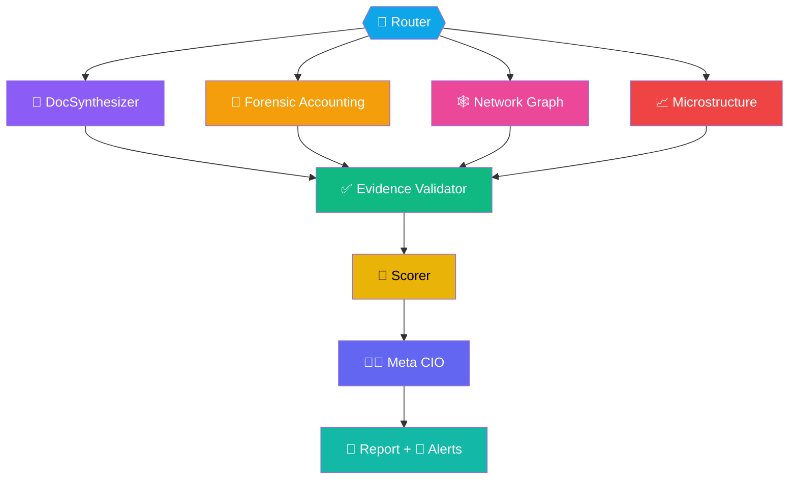
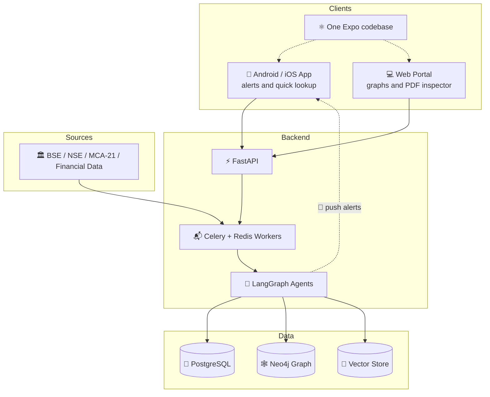

<!-- ═══════════════════════ ANIMATED HEADER ═══════════════════════ -->
<p align="center">
  
</p>

<p align="center">
  <a href="https://git.io/typing-svg">
    
  </a>
</p>

<p align="center">
  
  
  
  
</p>

<p align="center">
  
  
  
  
  
  
  
  
  
</p>

---

# 🕵️ Abhimanyu — AI-Powered Stock Market Intelligence & Fraud Detection Platform

<p align="center">
  <strong>✨ Uncovering Financial Deception. Protecting Investor Confidence. ✨</strong>
</p>

<p align="center">
  An AI-powered financial investigation platform designed to identify suspicious corporate activities, uncover hidden promoter relationships, and detect potential financial fraud in the Indian stock market.
</p>

<p align="center">
  
</p>

## 📑 Table of Contents

| | Section | | Section |
|---|---|---|---|
| 🚀 | [About Abhimanyu](#-about-abhimanyu) | 🏛️ | [Architecture at a Glance](#️-architecture-at-a-glance) |
| 🎯 | [The Problem](#-the-problem) | 🧪 | [Detection Domains](#-detection-domains) |
| 🧠 | [Core Features](#-core-features) | 🏗️ | [Project Documentation](#️-project-documentation) |
| ⚙️ | [How Abhimanyu Works](#️-how-abhimanyu-works) | 🔬 | [Our Approach](#-our-approach) |
| 🤖 | [Meet the AI Detective Team](#-meet-the-ai-detective-team) | 🛠️ | [Technology Stack](#️-technology-stack) |
| 🗺️ | [Roadmap](#️-roadmap) | 👥 | [Development Team](#-development-team) |
| ⚠️ | [Disclaimer](#️-disclaimer) | 🌟 | [Our Vision](#-our-vision) |

---

## 🚀 About Abhimanyu

**Abhimanyu** is an AI-based stock market intelligence and investment platform that acts as a team of autonomous financial detectives, continuously analyzing corporate disclosures, financial statements, and market-related information to protect investors.

Traditional stock market platforms primarily focus on price movements, technical indicators, and market predictions.

Abhimanyu takes a different approach.

Instead of simply predicting whether a stock will rise or fall, it investigates the underlying financial health and credibility of companies.

It analyzes thousands of pages of complex corporate filings, identifies suspicious financial patterns, uncovers potentially undisclosed relationships between company promoters, and flags warning signs of accounting irregularities and pump-and-dump schemes.

> 🎯 **Our mission is simple: Make financial deception harder to hide and investment decisions more informed.**

### 💡 In Plain Words

> Imagine hiring a whole team of forensic accountants, compliance officers, and data scientists to investigate a company **in seconds**. Instead of staring at stock charts, Abhimanyu reads the dense, boring documents, runs the math that exposes fake earnings, and connects the dots between directors, then gives you a clear **Red Flag Score** *before* you lose your savings.

### 📊 Price Apps vs Abhimanyu

| | 📈 Typical Stock Apps | 🕵️ Abhimanyu |
|---|---|---|
| **Focus** | Price, charts, predictions | Company honesty and governance |
| **Reads** | Market data | 400-page annual reports, auditor notes, filings |
| **Answers** | "Will it go up?" | "Can I trust the management?" |
| **Relationships** | Not covered | Promoter and director network mapping |
| **Output** | Buy / sell signals | Evidence-backed, explainable risk indicators |

## 🎯 The Problem

The Indian stock market contains enormous amounts of publicly available financial information. However, extracting meaningful insights from this information is difficult for ordinary investors.

Some major challenges include:

- 📚 **Complex Financial Filings:** Annual reports, audit reports, and corporate disclosures are lengthy and difficult to understand.
- 🕸️ **Hidden Promoter Relationships:** Undisclosed or suspicious connections between promoters, directors, and associated companies can be difficult to identify.
- 🧮 **Accounting Irregularities:** Financial manipulation and suspicious accounting patterns may remain unnoticed.
- 🎢 **Pump-and-Dump Schemes:** Artificial price inflation and coordinated market manipulation can expose retail investors to significant losses.
- ⚖️ **Information Asymmetry:** Institutional investors often have more resources to investigate companies than individual investors.

> 🌉 Abhimanyu aims to bridge this information gap through AI-powered financial investigation.

By the time a regulator acts, the share price has usually already collapsed. The clues, however, were often sitting in public documents all along.

## 🧠 Core Features

### 1. 🔎 AI-Powered Financial Investigation
- Analyze annual reports and corporate financial statements.
- Extract meaningful information from lengthy financial documents.
- Identify inconsistencies across financial disclosures.
- Generate simplified financial investigation reports.

### 2. 🕸️ Promoter Relationship Intelligence
- Investigate relationships between promoters, directors, and associated entities.
- Identify suspicious corporate connections.
- Build relationship networks to visualize potentially concerning associations.
- Highlight unusual patterns in corporate ownership and affiliations.

### 3. 🧮 Accounting Fraud Detection
- Detect unusual financial patterns and accounting inconsistencies.
- Identify suspicious changes in revenue, expenses, and reported profits.
- Analyze discrepancies between reported earnings and cash flows.
- Generate explainable financial risk indicators.

### 4. 🎢 Pump-and-Dump Detection
- Investigate abnormal trading and price-volume patterns.
- Identify unusual market activity.
- Correlate market movements with available corporate announcements and disclosures.
- Flag potential manipulation patterns for further investigation.

### 5. 🚦 AI Financial Risk Assessment
- Evaluate multiple financial and corporate risk indicators.
- Generate company risk assessments.
- Explain the factors contributing to detected warning signals.
- Provide evidence-backed investigation summaries.

### 6. 💬 Intelligent Investment Insights
- Present complex financial information in an understandable format.
- Help investors investigate companies before making investment decisions.
- Provide transparent risk indicators rather than guaranteed stock price predictions.

### 🚦 The Red Flag Score

Every analyzed company receives an explainable score from **0 to 100**, broken down by detection domain.

| Score | Risk Band | Meaning |
|---|---|---|
| 🟢 **0 – 24** | Low | No significant warning indicators found |
| 🟡 **25 – 49** | Moderate | Some indicators worth monitoring |
| 🟠 **50 – 74** | Elevated | Multiple indicators, review carefully before investing |
| 🔴 **75 – 100** | High | Strong, corroborated warning indicators |

> 🧾 Every flag shows its **evidence**: the filing page, the metric, the relationship path, or the trading pattern behind it.

## ⚙️ How Abhimanyu Works

Abhimanyu follows an intelligent financial investigation pipeline:

1. 📥 **Data Collection:** Collect publicly available corporate filings, financial statements, market information, and relevant disclosures.
2. 📄 **Document Processing:** Extract and structure information from complex financial documents.
3. 🧠 **AI Analysis:** Use AI-powered analysis to understand financial information and identify suspicious patterns.
4. 🕸️ **Relationship Mapping:** Investigate connections between promoters, directors, and corporate entities.
5. 🚨 **Fraud Detection:** Apply financial analysis and anomaly detection methodologies to identify potential warning signals.
6. 🚦 **Risk Assessment:** Combine investigation findings into explainable risk assessments.
7. 📊 **Investor Intelligence:** Present findings through an accessible dashboard and detailed investigation reports.


## 🤖 Meet the AI Detective Team

Instead of one model trying to know everything, Abhimanyu uses specialist agents that work in parallel, then combine their findings.

| Agent | Role | Superpower |
|---|---|---|
| 📖 **DocSynthesizer** | The Reader | Reads annual reports and auditor notes, returns findings with exact page references |
| 🧮 **Forensic Accounting** | The Number Cruncher | Beneish M-Score, cash flow vs profit divergence, earnings-quality checks |
| 🕸️ **Network Graph** | The Connector | Maps director and promoter links, finds circular money flows |
| 📈 **Microstructure Fraud** | The Market Watcher | Spots order book spoofing and suspicious volume before announcements |
| 🧑‍⚖️ **Meta CIO** | The Chief | Combines every signal, resolves conflicts, writes the final report |



## 🧪 Detection Domains

| # | Domain | What we look for |
|---|---|---|
| 1️⃣ | 🔁 **Related Party Transactions** | Circular money loops between linked companies, large loans to promoter-linked entities |
| 2️⃣ | 🏦 **Promoter Pledge Anomalies** | Sudden rises in pledged shares, hidden promoter-group entities |
| 3️⃣ | 🎭 **Sentiment vs Reality** | Upbeat management commentary that clashes with auditor notes and cash flows |
| 4️⃣ | 🎢 **Order Book Spoofing** | Abnormal order placement and cancellation, volume spikes before announcements |
| 5️⃣ | 🧾 **Accounting Quality** | Receivables growing faster than revenue, profit without cash, restatements |
| 6️⃣ | 🧑‍💼 **Auditor Signals** | Mid-term resignations, qualified opinions, going-concern doubts |

## 🏛️ Architecture at a Glance



| Layer | Highlights |
|---|---|
| ⚛️ **App (Expo + React Native)** | One TypeScript codebase for the website **and** the Android/iOS app (Expo Router) |
| 💻 **Web** | Interactive relationship graph, split-screen PDF inspector with highlighted evidence |
| 📱 **Mobile** | Quick lookup, offline report cache, push alerts (expo-notifications / FCM) |
| ⚡ **Backend** | FastAPI with asynchronous jobs so heavy analysis never blocks the app |
| 🧠 **Agents** | LangGraph orchestration with parallel specialist agents |
| 🗄️ **Data** | PostgreSQL for records, Neo4j for relationships, vector store for document search |

## 🏗️ Project Documentation

The project's technical documentation is maintained in the `docs/` directory.

| Documentation | Description |
|---|---|
| 🤖 [`AGENT.md`](docs/AGENT.md) | AI agent instructions and behavioral guidelines |
| 🧠 [`AI_SYSTEM_DESIGN.md`](docs/AI_SYSTEM_DESIGN.md) | AI system design and intelligence architecture |
| 🔌 [`API_SPECIFICATION.md`](docs/API_SPECIFICATION.md) | Backend API specifications |
| 🏛️ [`ARCHITECTURE.md`](docs/ARCHITECTTURE.md) | Overall system architecture |
| 📝 [`CHANGELOG.md`](docs/CHANGELOG.md) | Project version history and updates |
| 🗄️ [`DATA_SCHEMA.md`](docs/DATA_SCHEMA.md) | Database structure and data models |
| 📦 [`DATASET.md`](docs/DATASET.md) | Dataset sources and data descriptions |
| 🗺️ [`DEVELOPMENT_ROADMAP.md`](docs/DEVELOPMENT_ROADMAP.md) | Development phases and milestones |
| 🔀 [`FLOWCHART.md`](docs/FLOWCHART.md) | System workflows and process diagrams |
| 🚨 [`FRAUD_DETECTION_METHODOLOGY.md`](docs/FRAUD_DETECTION_METHODOLOGY.md) | Fraud detection approaches and methodologies |
| 📚 [`KNOWLEDGE_BASE.md`](docs/KNOWLEDGE_BASE.md) | Financial knowledge base and reference information |
| 📋 [`PRD.md`](docs/PRD.md) | Product requirements document |
| 🔐 [`SECURITY.md`](docs/SECURITY.md) | Security architecture and practices |
| 🧰 [`Tech_Stack.md`](docs/Tech_Stack.md) | Technologies and development tools |
| 🎨 [`UI_UX_GUIDELINES.md`](docs/UI_UX_GUIDELINES.md) | Interface design and user experience guidelines |
| 🧭 [`ENGINEERING_PLAN.md`](docs/ENGINEERING_PLAN.md) | Stack decision (Expo universal app), repo layout, team workflow |
| 🧑‍💻 [`DEVELOPER_GUIDE.md`](docs/DEVELOPER_GUIDE.md) | Setup, daily workflow, Git/GitHub by hand, troubleshooting |

## 🔬 Our Approach

Abhimanyu is built around three fundamental principles:

**1. 🧾 Evidence Over Assumptions**

Every suspicious activity should be supported by identifiable financial data, corporate disclosures, or relevant indicators.

**2. 💡 Explainable AI**

The platform should explain why a company has been flagged instead of presenting unexplained risk scores.

**3. 🛡️ Investor Protection**

The objective is to empower investors with better financial intelligence, transparency, and awareness of potential risks.

### 🧭 Built-in Safety Rules

- ✅ No flag is shown without evidence.
- ✅ Findings are worded as **risk indicators for review**, never as accusations.
- ✅ Relationships the system *infers* are labeled as **"possible links"** until verified.
- ✅ Missing data is reported as missing, never guessed.
- ✅ Analysts can confirm or dismiss flags, and their feedback improves the system.

## 🛠️ Technology Stack

The complete technology stack, frameworks, databases, AI models, and infrastructure are documented in:

📄 [`docs/Tech_Stack.md`](docs/Tech_Stack.md)

**Quick preview**

| Area | Technologies |
|---|---|
| 🧠 AI and Agents | LangGraph, LangChain, LlamaIndex, Google Gemini Flash, Groq |
| 📊 ML and Math | XGBoost, Isolation Forest, Beneish M-Score, scikit-learn |
| ⚡ Backend | Python, FastAPI, Celery, Redis |
| 🗄️ Databases | PostgreSQL (Supabase), Neo4j, ChromaDB |
| 🕷️ Data Collection | Playwright, BeautifulSoup, Tesseract OCR |
| 💻 Web + 📱 Mobile | Expo (React Native + React Native Web), Expo Router, TypeScript, TanStack Query, Cytoscape.js, PDF.js |
| 🔔 Alerts | expo-notifications (Firebase Cloud Messaging / APNs) |

> 💸 The prototype is designed to run on **free-tier and open-source tools**.

## 🗺️ Roadmap

| Phase | Focus | Status |
|---|---|---|
| 🧱 **Phase 0** | Documentation and system design | ✅ Done |
| 📥 **Phase 1** | Data pipelines: BSE/NSE filings, financials, MCA-21 director data | ⏳ Planned |
| 🧮 **Phase 2** | Forensic accounting engine (M-Score, cash-quality checks) | ⏳ Planned |
| 📖 **Phase 3** | DocSynthesizer: annual report and auditor note extraction | ⏳ Planned |
| 🕸️ **Phase 4** | Relationship graph and circular-flow detection | ⏳ Planned |
| 🧑‍⚖️ **Phase 5** | Meta CIO, scoring, and report generation | ⏳ Planned |
| 📱 **Phase 6** | Web portal, mobile app, and push alerts | ⏳ Planned |
| 📈 **Phase 7** | Order book anomaly detection | ⏳ Planned |

> 📌 Full details live in [`docs/DEVELOPMENT_ROADMAP.md`](docs/DEVELOPMENT_ROADMAP.md).

## 📂 Repository Structure

```text
Abhimanyu/
├── ⚙️ abhi / abhi.cmd       # Team toolkit: setup, sync, finish, rescue, help
├── 📁 frontend/             # Expo app: website + Android + iOS (one codebase)
├── 📁 backend/              # FastAPI service (agents, ingestion, workers to come)
├── 📁 docs/                 # Full technical documentation
├── 📁 scripts/abhi/         # Toolkit source
├── 📁 .github/workflows/    # CI: type-check, lint, build, tests
└── 📄 README.md
```

## 🚀 Getting Started (team)

**First time on a PC.** Create an empty `Abhimanyu` folder, open a terminal in it, and run:

```powershell
# Windows (PowerShell)
irm https://raw.githubusercontent.com/arijeetdas/Abhimanyu/main/abhi.cmd -OutFile abhi.cmd; .abhi setup
```

```bash
# macOS / Linux
curl -fsSLO https://raw.githubusercontent.com/arijeetdas/Abhimanyu/main/abhi && chmod +x abhi && ./abhi setup
```

**Every session:**

| | Windows | macOS / Linux |
|---|---|---|
| ▶️ Start (sync + run the app) | `.abhi start` | `./abhi start` |
| ⬆️ Finish (commit + push) | `.abhi finish` | `./abhi finish` |
| 🧭 Menu / 🆘 stuck / 📖 manual | `.abhi` · `.abhi rescue` · `.abhi help` | `./abhi` · `./abhi rescue` · `./abhi help` |

📖 Full manual, including every step by hand: [`docs/DEVELOPER_GUIDE.md`](docs/DEVELOPER_GUIDE.md) · 🧭 Why Expo and how we work: [`docs/ENGINEERING_PLAN.md`](docs/ENGINEERING_PLAN.md)

## 👥 Development Team

Abhimanyu is developed collaboratively by a team of **4 members**, combining software development, artificial intelligence, financial analysis, and data investigation.

<p align="center">
  
</p>

<table align="center">
  <tr>
    <td align="center" width="200">
      <br/>
      
    </td>
    <td align="center" width="200">
      <br/>
      
    </td>
    <td align="center" width="200">
      <br/>
      
    </td>
    <td align="center" width="200">
      <br/>
      
    </td>
    <td align="center" width="200">
      <br/>
      
    </td>
  </tr>
</table>

<p align="center">
  
  
  
  
  
</p>

| Focus Area | Responsibility |
|---|---|
| 🎨 **Frontend** | Expo app: website + Android/iOS from one codebase |
| 🕷️ **Data Pipelines** | Scrapers, filings ingestion, database loading |
| 🤖 **Agentic AI** | LangGraph orchestration, document analysis, prompts |
| 🧮 **ML and Graph** | Anomaly detection, forensic metrics, Neo4j graph |

Our goal is to build an intelligent system that makes corporate financial investigation more accessible, scalable, and transparent.

## 🤝 Contributing

Contributions and ideas are welcome.

1. ▶️ Run `abhi start` to get the latest work
2. 🌿 For bigger features, `abhi branch` creates a feature branch
3. ✍️ Update the relevant file in `docs/` if your change affects design
4. 📝 `abhi finish` commits, adds a [`CHANGELOG`](docs/CHANGELOG.md) entry, and pushes (or opens a pull request)

Outside contributors: fork the repository and open a pull request.

## ⚠️ Disclaimer

> [!WARNING]
> Abhimanyu is an experimental financial intelligence and fraud detection platform.

- Detected anomalies and risk indicators do not establish that fraud has occurred.
- AI-generated findings should be independently verified.
- The platform does not guarantee stock market predictions or investment returns.
- This platform is intended to support research and informed decision-making, not replace professional financial advice.

## 🌟 Our Vision

We envision a stock market where investors are not forced to rely solely on headlines, speculation, or incomplete financial information.

**Abhimanyu aims to bring intelligent financial investigation to every investor.**

---

<p align="center">
  
</p>

<p align="center">
  <strong>ABHIMANYU</strong><br/>
  <i>Investigate Beyond the Numbers. Invest Beyond the Noise.</i>
</p>

<p align="center">
  
</p>

<p align="center">
  
</p>
